<p align="center">
  
</p>

<h1 align="center">Parem Launcher</h1>

<h3 align="center">You go first.</h3>

<p align="center">
  A home screen that waits for you to start. Parem is a minimal, text-based Android launcher: a short list of app names, one search field that answers and stops, notifications that can wait, and a speed bump before the apps that eat your day.
</p>

<p align="center">
  <a href="https://github.com/Pilves/parem-launcher/releases/latest"><strong>Download the latest release</strong></a><br>
  <a href="#help-test-on-google-play"><strong>Join the Google Play test</strong></a>
</p>

<p align="center">
  <sub>Android 10 or newer &middot; Open source under GNU GPLv3</sub><br>
  <sub>No ads, no accounts, no purchases</sub><br>
  <sub>Built with AI, and <a href="#built-with-ai">open about it</a></sub>
</p>

<p align="center">
  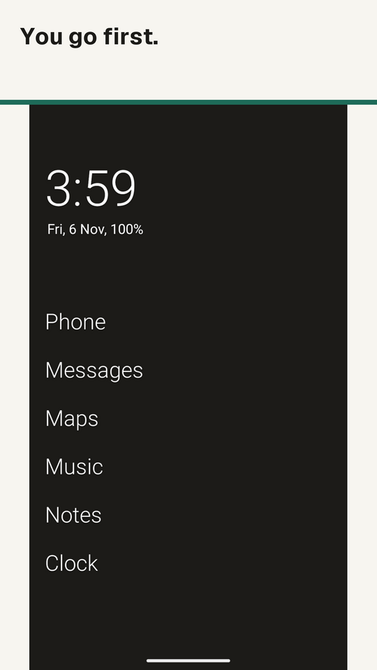
  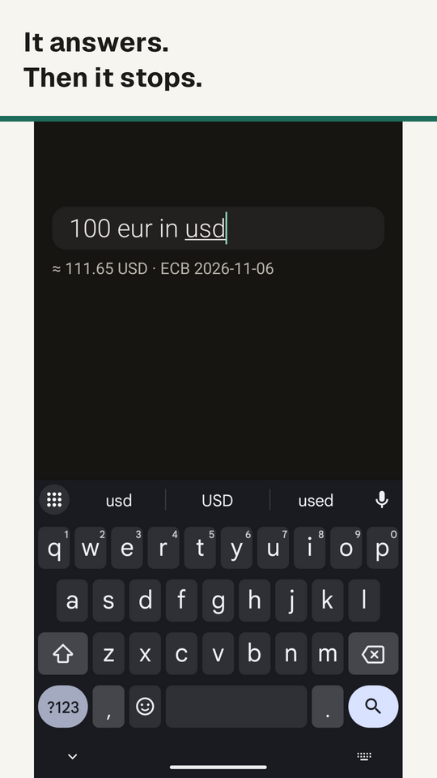
  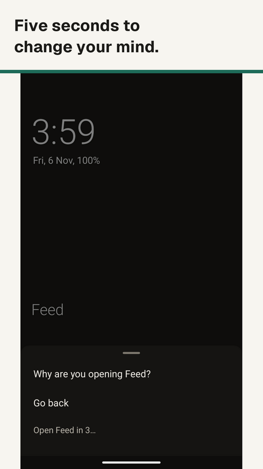
</p>

<p align="center">
  <sub>Play debug build on an emulator, with sample apps and notifications. The currency rate is a recorded test result, not a live quote.</sub>
</p>

## Built with AI

Parem was built with AI. Patrick has not written its code by hand. In Patrick's words:

> i havent written a single line. olauncher was close but not it so i forked and vibed and then it diverged into parem and now we are here

There has been no human code review or independent security audit for this release. The release build has been checked on one Nothing phone and one Samsung tablet.

The source, tests and CI runs are public, so you can check the work yourself. They are evidence of checks, not a guarantee. [Read the story](https://pilves.github.io/parem-launcher/story/).

[](https://github.com/Pilves/parem-launcher/actions/workflows/debug-build.yml)

## What it does

**Minimal but hyperfunctional.** Parem strips your home screen to what matters, then packs real utility behind a single search bar. It is for less screen time or a proper digital detox, without swapping your smartphone for a dumbphone.

### A home screen made of words

- Up to 8 apps as plain text under your clock and date. Icons and icon packs are optional.
- Folders, website shortcuts and resizable widgets.
- Swipes and double tap do what you tell them. Optional gesture letters open apps.

### One search field, no hunting

Swipe up and type. Initials and partial names work, and a single match opens by itself unless you turn that off. The same field does the rest:

| Type | You get |
|---|---|
| `gm` | Google Maps, by initials |
| `s ki` | Shaurmas Kitchen, by word prefixes |
| `2+2` | A live result, with `+ - * / % ^` and parentheses. Tap it or press Enter to copy it |
| `5 km to mi` | A unit conversion |
| `100 eur in usd` | A currency conversion at European Central Bank rates |
| `alarm 7:30`, `timer 10m` | The details passed to your Clock app |
| `event friday 3pm dentist` | The details passed to your Calendar app |
| `0612 3456` | Enter opens the dialer with that number |
| A leading space, then your query | Enter searches Google |
| `!w query` | A DuckDuckGo bang search, also `!yt` and others |

It also finds app shortcuts and Parem's own settings, and your contacts if you opt in.

### Calm phone tools

All off until you turn them on, and each says what it needs first.

- **Screen time:** today's total on home, a 7-day graph and a weekly review.
- **App limits:** a daily allowance per app, then a warning you can override.
- **Mindful pause:** choose any app for a question and a five-second wait before it opens.
- **Focus mode:** timed sessions or weekly schedules. Up to 5 allowed apps, and your phone app is never blocked.
- **Quiet notifications:** apps you haven't allowed move out of the shade into a quiet list. Calls, alarms, media, navigation and emergency alerts stay visible, and hidden items return within 8 hours. A short sound or vibration may still play unless you choose Make silent.
- **Grayscale:** now, during focus, after a limit, or per app. Needs a one-time developer-tools permission, granted from a computer. The GitHub APK can also do this on the phone.

Screen time, app limits and mindful pause need usage access. Quiet notifications need notification access.

**Straight talk:** limits, pause and focus only cover apps opened through Parem. They are speed bumps, not a lock. You can always get past them.

<p align="center">
  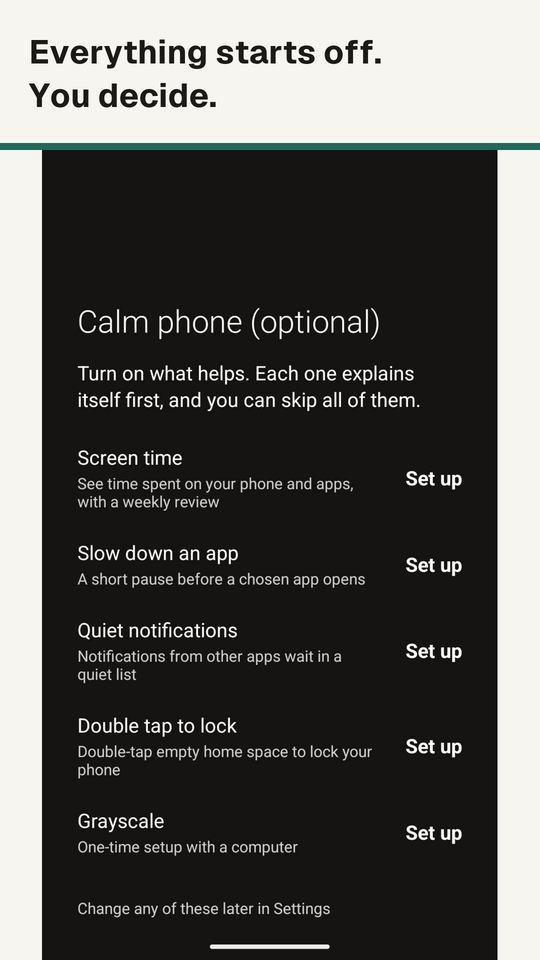
  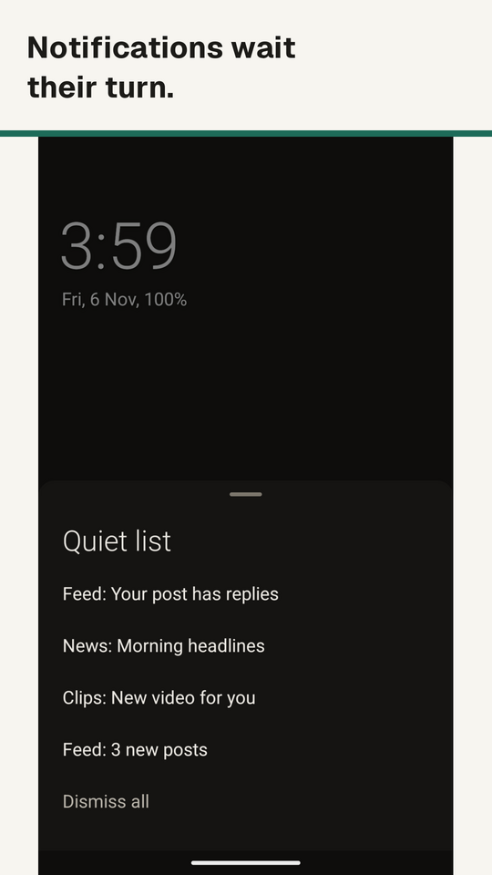
  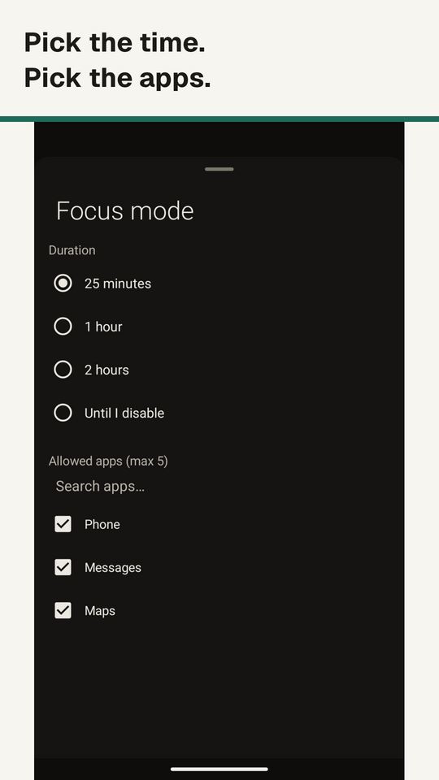
</p>

### Light or dark

Dark, light or system theme, switched on a schedule or with sunrise and sunset if you like.

<p align="center">
  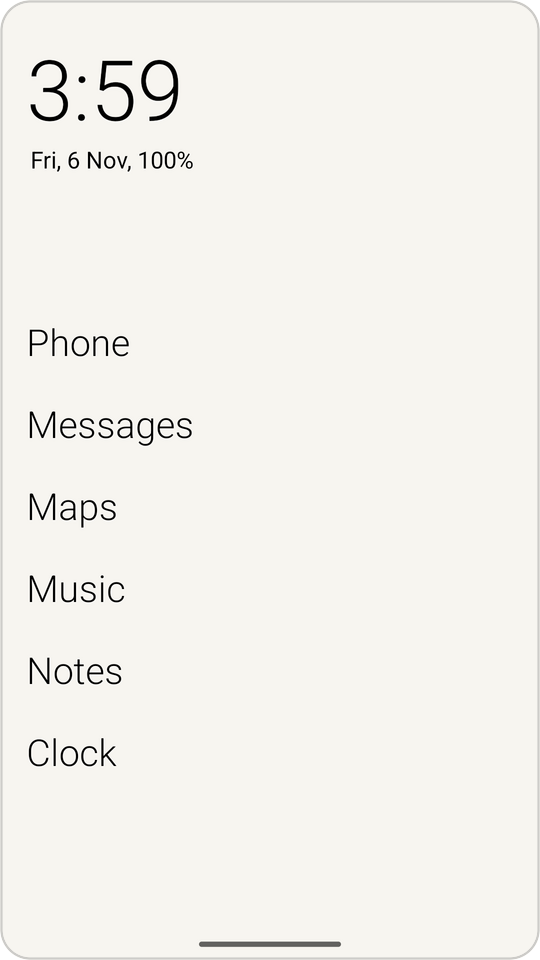
  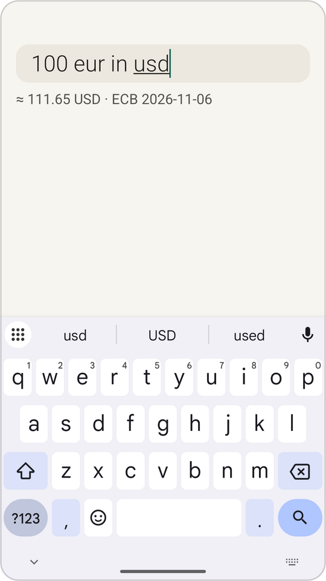
  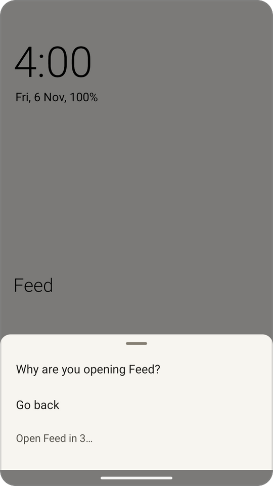
  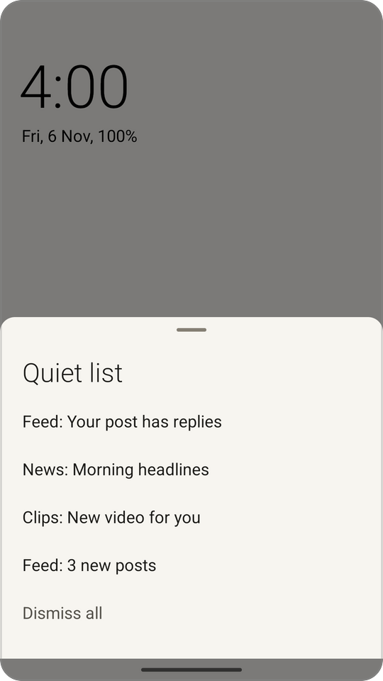
  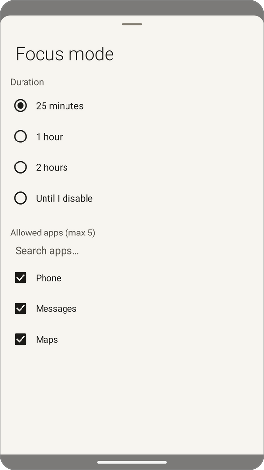
</p>

### What goes online, and what doesn't

Parem has no account, no server of its own, and no analytics, ad or tracking code. Contacts, notifications and app search are handled on your phone, and Parem never asks for your location.

It does go online for these:

- **Weather, off by default:** the city you search for and pick, then its rounded coordinates, go to Open-Meteo.
- **Daily wallpaper, off by default:** a list from GitHub, then images from third-party hosts.
- **Currency, when you type a conversion:** a fixed download of European Central Bank rates, at most daily. Your query isn't in it.

Those services see your IP address, like any connection. Web searches open in your browser (Google after a leading space, DuckDuckGo for `!bangs`). Parem's crash reports are off by default and sent only by you. On the Play build, Android can also report crashes to Google if your phone shares diagnostics.

Android cloud backup leaves Parem out, and Export settings moves your setup. A phone-to-phone transfer you start on Android 12 or later can still carry your settings.

Double tap to lock is optional. After you agree, it uses Android's accessibility service only to lock the screen. The service sees only taps inside Parem and cannot read your screen.

The [privacy policy](https://pilves.github.io/parem-launcher/privacy.html) goes through all of it, feature by feature.

## Get Parem

Parem needs Android 10 or newer. It replaces your home screen, so setup asks you to make it your home app. Your apps stay installed and you can switch back any time.

**From GitHub:** download the APK from the [latest release](https://github.com/Pilves/parem-launcher/releases/latest) and install it. To update, install the new APK over your existing one, without uninstalling or clearing data. Exporting settings first gives you a backup.

**From Google Play:** Parem is in a closed test, so getting it takes [a few steps](#help-test-on-google-play).

The GitHub APK can also grant grayscale by pairing over wireless debugging on the phone. The Play build grants it from a computer only. The two are signed differently, so moving between them means uninstalling, which erases Parem's data. Use Export settings first.

## Help test on Google Play

Parem is in a closed test on Google Play. Real phones and real habits are what it needs most.

**Join the group first, then open the test link. The order matters.**

1. **Join the group.** Open the [tester group](https://groups.google.com/g/parem-testers) and join with the Google account you use for Play on your phone.
2. **Then open the test.** On your Android phone, open the [Play test link](https://play.google.com/apps/testing/com.parem.launcher) with that same account and tap Become a tester.
3. **Install Parem** from Google Play.

Already using the GitHub APK? Export your settings and uninstall it before step 3.

Send bugs and rough edges to [info@chaidla.ee](mailto:info@chaidla.ee). To include a crash report, turn on Settings > Parem Launcher > Crash reports. After a crash, Parem offers the report the next time it starts, and you choose whether to send it.

## More detail

<details>
<summary><strong>Full feature list</strong></summary>

### Minimal home screen

- Text-only home screen with up to 8 pinned apps
- Swipe gestures: up for app drawer, down for notifications or search, left/right for configurable actions
- Date, time, battery and weather at a glance
- Dark, light or system theme with automatic scheduling (manual times or sunrise/sunset)
- Configurable text size, alignment and daily wallpaper rotation

### Widgets

- Add multiple widgets to your home screen (long-press > Add widget)
- Drag the handle under a widget to resize it
- Swap, remove, reorder or place widgets above or below your app list
- Search and filter in the widget picker

### Digital wellbeing

- **Focus mode:** timed sessions (25 minutes, 1 hour, 2 hours, or until you disable it) or weekly schedules that block all but up to 5 allowed apps
- **Screen time graph:** 7-day usage bar chart. Tap the home screen time display to view it
- **Screen time limits:** soft per-app time limits with warnings when exceeded
- **Mindful pause:** choose any app for a five-second pause before opening it through Parem. A time limit is optional
- **Configurable double tap:** lock screen, open app, notifications, search, camera, flashlight or nothing

### App drawer

- Per-app daily usage time and open count ("1h 23m · 7×") shown next to each app
- Sort apps by usage time
- Long-press menu: uninstall, rename, hide, set time limit, app info
- App renaming and per-profile (work profile) support

### Gestures and shortcuts

- **Custom swipe actions:** left and right swipes can open an app, notifications, the quiet list, search, lock screen, camera, flashlight, or do nothing
- **Gesture letters:** draw letter shapes (A, C, L, M, N, O, S, V, W, Z) on the home screen to launch assigned apps
- **App folders:** group up to 4 apps into a named folder on any home screen slot

### Personalization

- **Icon packs:** load icons from third-party ADW-compatible icon packs
- **Weather display:** current temperature on the home screen date line via Open-Meteo (free, no API key)
- **Theme schedule:** automatic dark/light switching by time or sunrise/sunset
- **Settings backup and restore:** export/import supported settings as JSON. Android cloud backup leaves Parem out

### Also included

Tablets and foldables, TalkBack, hardware keyboards, Android font sizes up to 200%, work profiles, and Private Space on Android 15 and later.

</details>

<details>
<summary><strong>Build from source</strong></summary>

```
# Requires Android SDK (min SDK 29, target 36), JDK 17+
./gradlew assembleFullDebug
```

The debug APK lands at `app/build/outputs/apk/full/debug/app-full-debug.apk`.

</details>

<details>
<summary><strong>Project docs</strong></summary>

- [ARCHITECTURE.md](ARCHITECTURE.md): code map, release process, and notes on building on ARM64 hosts (e.g. a Raspberry Pi)
- [ONBOARDING.md](ONBOARDING.md): how to find your way around the code and ship a first change
- [CHANGELOG.md](CHANGELOG.md): what changed in each release

</details>

## Origins

Originally forked from [Olauncher](https://github.com/tanujnotes/Olauncher) by [tanujnotes](https://github.com/tanujnotes). This project has since diverged significantly with a full digital wellbeing suite, multi-widget system, omnibox search, gesture shortcuts and many other features. The original launcher and its contributors remain part of its story.

## Licence

Free and open source under the [GNU GPLv3](https://www.gnu.org/licenses/gpl-3.0.en.html). See [LICENSE](LICENSE).

<p align="center">
  <br>
  Parem is Estonian for "better". As in: better things to do than stare at a phone.
</p>
