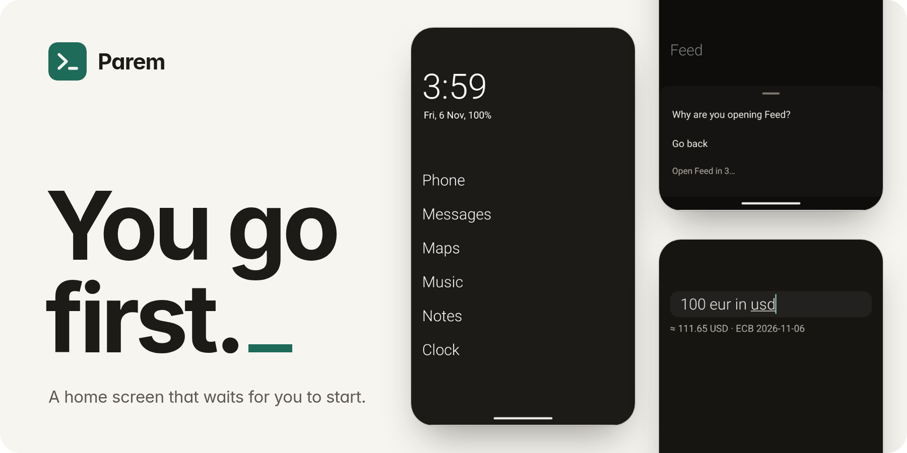
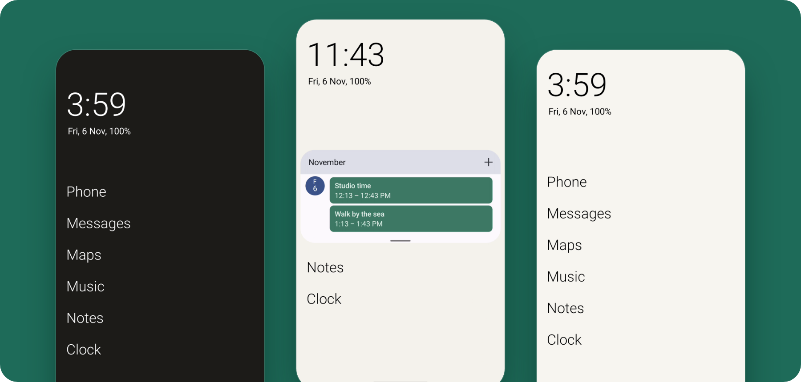
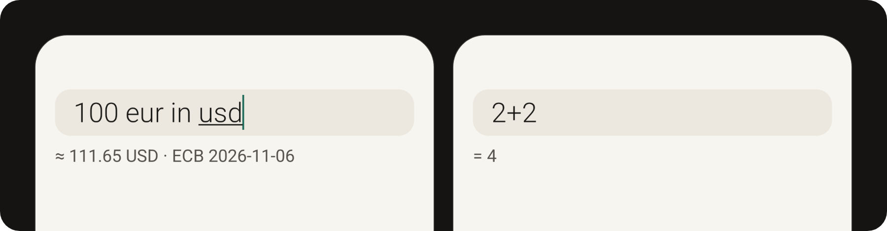
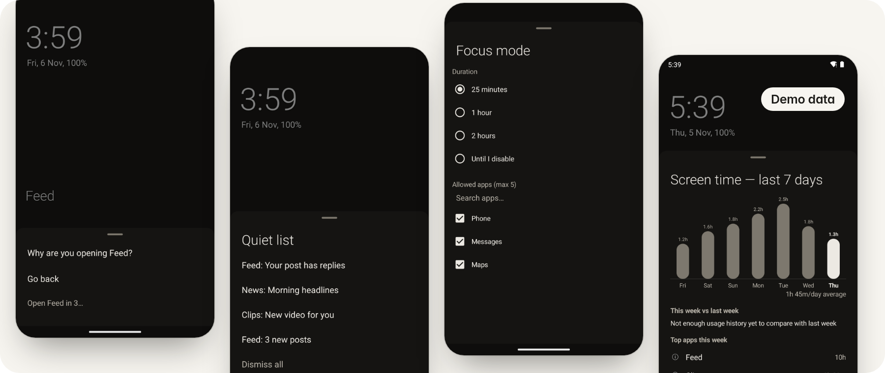

<picture>
  <source media="(prefers-color-scheme: dark)" srcset="docs/images/hero-dark.png">
  
</picture>

<p align="center">
  <a href="https://github.com/Pilves/parem-launcher/releases/latest"></a>
  
  <a href="LICENSE"></a>
  <a href="https://github.com/Pilves/parem-launcher/actions/workflows/debug-build.yml"></a>
</p>

<p align="center">
  Parem is a text-based Android launcher: a short list of apps, one search field that answers and stops, and a speed bump before the apps that eat your day.
</p>

<p align="center"><strong>No ads. No accounts. No catch.</strong></p>

<p align="center">
  <a href="https://github.com/Pilves/parem-launcher/releases/latest"><strong>Download the APK</strong></a>
  &nbsp;&middot;&nbsp;
  <a href="#google-play"><strong>Join the Google Play test</strong></a>
  &nbsp;&middot;&nbsp;
  <a href="https://pilves.github.io/parem-launcher/">Website</a>
</p>

## A home screen made of words



Your clock, your date and up to 8 apps, as plain text. No feed asking for your attention.

- **Your layout.** Folders, website shortcuts and resizable widgets, when a list isn't enough.
- **Your gestures.** Swipes and double tap do what you tell them. Optional gesture letters open apps.
- **Your look.** Dark, light or system theme, switched on a schedule or with sunrise and sunset. Icons and icon packs are optional.

## It answers. Then it stops.



Swipe up and type. Initials and partial names work. A single app match can open by itself; you can turn this off, and it is suppressed for screen readers and value queries. The same field does the rest:

| Type | You get |
|---|---|
| `gm` | Google Maps, by initials |
| `s ki` | Shaurmas Kitchen, by word prefixes |
| `2+2` | A live result, with `+ - * / % ^` and parentheses. Tap it or press Enter to copy it |
| `5 km to mi` | A unit conversion |
| `100 eur in usd` | A currency conversion at European Central Bank rates |
| `alarm 7:30`, `timer 10m` | The details passed to your Clock app |
| `event friday 3pm dentist` | The details passed to your Calendar app |
| `0612 3456` | Enter opens the dialer with that number |
| A leading space, then your query | Enter searches Google |
| `!w query` | A DuckDuckGo bang search, also `!yt` and others |

It also finds app shortcuts and Parem's own settings, and your contacts if you opt in.

## Everything starts off. You decide.



Every calm tool is optional, and each says what it needs first.

- **Mindful pause:** choose any app for a question and a five-second wait before it opens.
- **Quiet notifications:** eligible notifications from apps you haven't allowed move out of the shade into a quiet list. Calls, alarms, media, navigation and emergency alerts stay visible. Hidden items are snoozed for 8 hours and may be hidden again while the filter remains on. A short sound or vibration may still play unless you choose Make silent.
- **Focus mode:** timed sessions or weekly schedules. Up to 5 allowed apps; the default phone app is allowed when Android identifies it.
- **Screen time:** today's total on home, a 7-day graph and a weekly review.
- **App limits:** a daily allowance per app, then a warning you can override.
- **Grayscale:** now, during focus, after a limit, or per app. Needs a one-time developer-tools permission, granted from a computer. The GitHub APK can also do this on the phone.

Screen time and app limits need usage access. Mindful pause can be enabled without it. Quiet notifications need notification access.

Limits, pause and focus cover apps opened through Parem. They are speed bumps, not a lock, and you can always get past them.

<sub>Screens show sample apps and notifications. The screen time chart uses demo data.</sub>

<details>
<summary><strong>Full feature list</strong></summary>

### Minimal home screen

- Text-only home screen with up to 8 pinned apps
- Swipe gestures: up for app drawer, down for notifications or search, left/right for configurable actions
- Date, time, battery and weather at a glance
- Dark, light or system theme with automatic scheduling (manual times or sunrise/sunset)
- Configurable text size, alignment and daily wallpaper rotation

### Widgets

- Add multiple widgets to your home screen (long-press > Add widget)
- Drag the handle under a widget to resize it
- Swap, remove, reorder or place widgets above or below your app list
- Search and filter in the widget picker

### Digital wellbeing

- **Focus mode:** timed sessions (25 minutes, 1 hour, 2 hours, or until you disable it) or weekly schedules that block all but up to 5 allowed apps
- **Screen time graph:** 7-day usage bar chart. Tap the home screen time display to view it
- **Screen time limits:** soft per-app time limits with warnings when exceeded
- **Mindful pause:** choose any app for a five-second pause before opening it through Parem. A time limit is optional
- **Configurable double tap:** lock screen, open app, notifications, search, camera, flashlight or nothing

### App drawer

- Per-app daily usage time and open count ("1h 23m · 7×") shown next to apps with recorded activity; usage time requires usage access
- Sort apps by usage time
- Long-press menu: uninstall, rename, hide, set time limit, app info
- App renaming and per-profile (work profile) support

### Gestures and shortcuts

- **Custom swipe actions:** left and right swipes can open an app, notifications, the quiet list, search, lock screen, camera, flashlight, or do nothing
- **Gesture letters:** draw letter shapes (A, C, L, M, N, O, S, V, W, Z) on the home screen to launch assigned apps
- **App folders:** group up to 4 apps into a named folder on any home screen slot

### Personalization

- **Icon packs:** load icons from third-party ADW-compatible icon packs
- **Weather display:** current temperature on the home screen date line via Open-Meteo (free, no API key)
- **Theme schedule:** automatic dark/light switching by time or sunrise/sunset
- **Settings backup and restore:** export/import supported settings as JSON. Android cloud backup leaves Parem out

### Also included

Tablets and foldables, TalkBack, hardware keyboards, Android font sizes up to 200%, work profiles, and Private Space on Android 15 and later.

</details>

## What goes online

Parem has no account, no server of its own, and no analytics, ad or tracking code. Contacts, notifications and app search are handled on your phone, and Parem never requests your device's location permission.

| Feature | When | What happens |
|---|---|---|
| Weather | Off by default | The place name you type, then the rounded coordinates of the one you pick, go to Open-Meteo |
| Daily wallpaper | Off by default | A list from GitHub, then images from third-party hosts |
| Currency | When you type a conversion | A fixed download of European Central Bank rates, at most daily. Your query isn't in it |

Like any connection, these show the service your IP address and the time, and Android's standard header adds your Android version and phone model. Web searches open in your browser (Google after a leading space, DuckDuckGo for `!bangs`).

Parem's crash reports are off by default and sent only by you. On the Play build, Android can also report crashes to Google if your phone shares diagnostics.

From 6.0.0, Android cloud backup leaves Parem out, and Export settings moves your setup. A phone-to-phone transfer you start on Android 12 or later can still carry your settings.

Double tap to lock is optional. After you agree, it uses Android's accessibility service only to lock the screen. The service sees only taps inside Parem and cannot read your screen. An optional device admin fallback also only locks the screen.

The [privacy policy](https://pilves.github.io/parem-launcher/privacy.html) goes through all of it, feature by feature.

## How Parem is made

Parem is directed by Patrick and written by AI coding agents, building on [Olauncher](https://github.com/tanujnotes/Olauncher) by [tanujnotes](https://github.com/tanujnotes) and its contributors. The source, tests and CI runs are public, so you can check the work yourself. [Read the story](https://pilves.github.io/parem-launcher/story/).

| Check | What runs |
|---|---|
| Unit tests | 400+ JVM tests on every push to `master`, for both build flavours |
| Device tests | A smoke suite on every pull request, on phone, foldable and tablet emulators running Android 14, plus a tablet on Android 16 |
| Upgrades | Every pull request builds v5.5.1, seeds it, upgrades in place and verifies the result |
| Performance | A pull request fails if cold start, return to home, drawer scrolling or typing gets more than 20% worse than a pinned reference build, beyond a noise floor |
| Release builds | Minified APKs of both flavours can be installed and smoke tested with the manual release-smoke workflow |
| Real hardware | The release build has been checked on a Nothing phone and a Samsung tablet |

Runtime dependencies are Kotlin, AndroidX and Material Components. There are no Google Play Services, Firebase or analytics SDKs.

## Get Parem

Parem needs Android 10 or newer. It replaces your home screen, so setup asks you to make it your home app. Your apps stay installed and you can switch back any time.

### GitHub

Download the APK from the [latest release](https://github.com/Pilves/parem-launcher/releases/latest) and install it. To update, install the new APK over your existing one, without uninstalling or clearing data. Exporting settings first gives you a backup.

### Google Play

Parem is in closed testing on Google Play. **Join the group first, then open the test link. The order matters.**

1. **Join the group.** Open the [tester group](https://groups.google.com/g/parem-testers) and join with the Google account you use for Play on your phone.
2. **Then open the test.** On your Android phone, open the [Play test link](https://play.google.com/apps/testing/com.parem.launcher) with that same account and tap Become a tester.
3. **Install Parem** from Google Play.

Already using the GitHub APK? Export your settings and uninstall it before step 3. If you turned on device admin locking, turn it off first in Parem's Settings > Gestures, or Android won't let you uninstall. The two builds are signed differently, so moving between them means uninstalling, which erases Parem's data.

The GitHub APK can also grant grayscale by pairing over wireless debugging on the phone. The Play build grants it from a computer only.

### Feedback

Send bugs and rough edges to [info@chaidla.ee](mailto:info@chaidla.ee) or open an [issue](https://github.com/Pilves/parem-launcher/issues). To include a crash report, turn on Settings > Parem Launcher > Crash reports. After a crash, Parem offers the report the next time it starts, and you choose whether to send it.

## Development

```sh
# Requires Android SDK (min SDK 29, target 36), JDK 17+
./gradlew assembleFullDebug
```

The debug APK lands at `app/build/outputs/apk/full/debug/app-full-debug.apk`.

- [ARCHITECTURE.md](ARCHITECTURE.md): code map, release process, and notes on building on ARM64 hosts (e.g. a Raspberry Pi)
- [ONBOARDING.md](ONBOARDING.md): how to find your way around the code and ship a first change
- [CONTRIBUTING.md](CONTRIBUTING.md): build checks and pull-request guidance
- [CHANGELOG.md](CHANGELOG.md): what changed in each release

## Credits and licence

Parem began as a fork of [Olauncher](https://github.com/tanujnotes/Olauncher) by [tanujnotes](https://github.com/tanujnotes). The original launcher and its contributors remain part of its story.

Free and open source under the [GNU GPLv3](https://www.gnu.org/licenses/gpl-3.0.en.html). See [LICENSE](LICENSE).

<p align="center">
  <br>
  Parem is Estonian for "better". As in: better things to do than stare at a phone.
</p>
